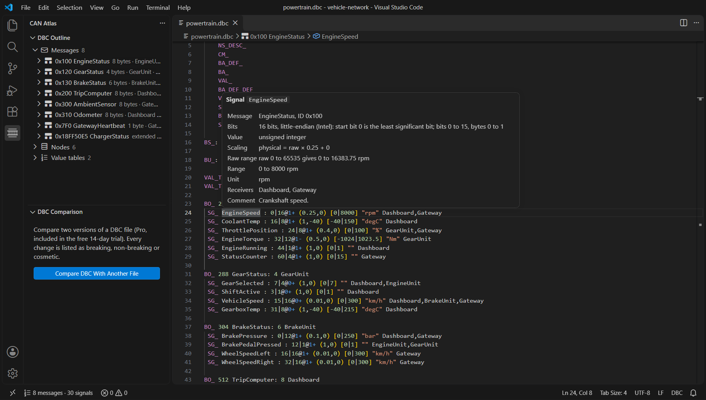
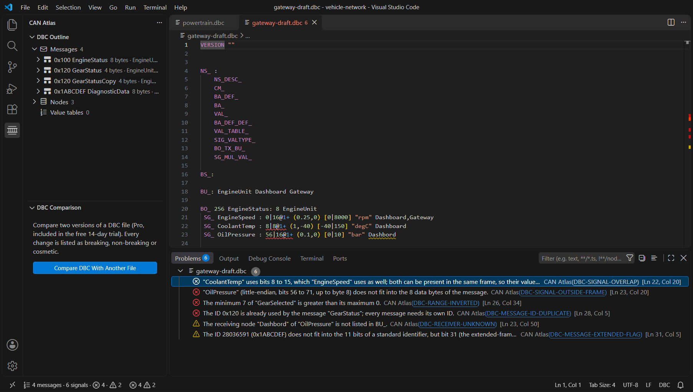
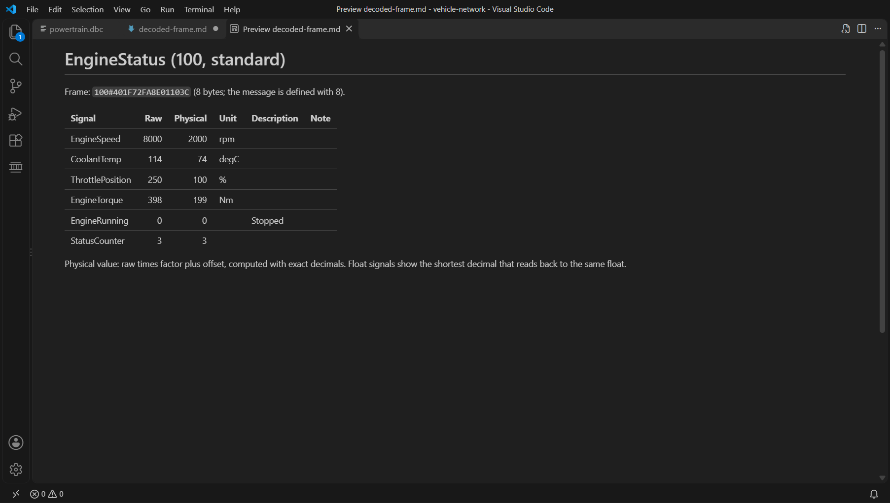
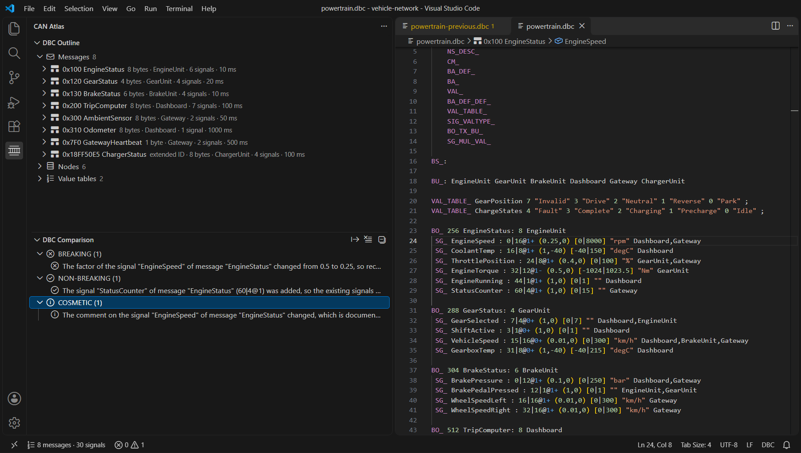
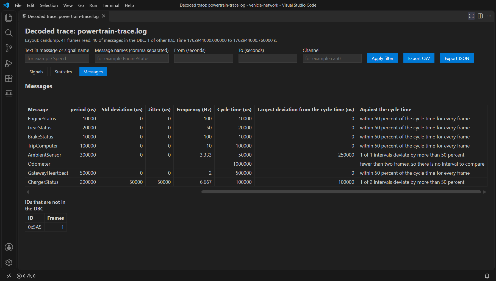

# CAN Atlas

**Read, check and decode CAN databases (DBC files) in VS Code.** CAN Atlas shows the messages, signals, nodes and value tables of a DBC file in an outline, explains every signal in a hover (bits in both byte orders, scaling, range, unit, receivers, value descriptions), lists structural mistakes as problems with stable codes (overlapping signals, a signal beyond the data length, a wrong extended-frame flag, a minimum above the maximum), decodes and encodes frames with exact arithmetic, and draws the bit layout of a message. **Pro** compares two versions of a database and classes every change as breaking, non-breaking or cosmetic, decodes whole trace files with statistics against the cycle times, draws the bit layout as a page, writes documentation, and checks several DBC files in a workspace against each other.

Made for integration and test engineers of vehicle and machine networks who read signal definitions, look for mistakes, decode frames and logs by hand and compare two releases of a database before a software drop. Everything runs on your computer, with no telemetry and no account.

## Screenshots

The DBC Outline and a hover on a signal:

Problems with codes, found in a sample file:

Decode Frame shows the raw and physical value of every signal:

Compare DBC With Another File (Pro) groups the changes as breaking, non-breaking and cosmetic:

Decode Trace With This DBC (Pro) with statistics per message:

## Free, trial and Pro

| Feature | Free | Trial (14 days) | Pro |
| --- | :---: | :---: | :---: |
| DBC language for `.dbc` files and syntax colouring | yes | yes | yes |
| DBC Outline view (messages by ID, signals, nodes, value tables), document symbols, folding | yes | yes | yes |
| Hover on signals, messages, nodes and value tables | yes | yes | yes |
| Go to definition and find references for messages, signals and nodes | yes | yes | yes |
| Problems with stable codes (61 codes: overlaps, frame limits, duplicates, unknown nodes, value tables, factors and ranges, multiplexing, extended-frame flags, names, attributes) | yes | yes | yes |
| Decode Frame, Encode Signals, Show Bit Layout, Go To Message, Check Current File | yes | yes | yes |
| Samples, walkthrough, Report A Problem | yes | yes | yes |
| Compare DBC With Another File, with Markdown, HTML and CSV reports | | yes | yes |
| Show Graphical Bit Layout | | yes | yes |
| Decode Trace With This DBC, with filters, statistics and CSV and JSON export | | yes | yes |
| Create DBC Documentation (Markdown, HTML) | | yes | yes |
| Export Signals As CSV, Create DBC From Signal CSV | | yes | yes |
| Create Workspace DBC Inventory (all DBC files of a folder, ID collisions between files) | | yes | yes |

* **Free** needs no key, no account and no network connection, for personal and commercial use. Free features will not be moved behind the key later.
* **Trial**: the first Pro command you run starts a free 14-day trial of every Pro feature on this computer. It is recorded only in the editor's storage on this computer (nothing is sent anywhere) and needs no key or account. **CAN Atlas: Show Licence Status** shows the days left.
* **Pro** is a one-time purchase, not a subscription: **Pro Personal USD 29** (one person, up to 3 computers, use at work allowed) or **Pro Business USD 59 per user** (for organisations; one key per user, each for up to 3 computers). Prices at the time of writing; the checkout page shows the final price and any taxes for your country. **CAN Atlas: Buy Pro** opens the checkout, the key arrives by e-mail, **CAN Atlas: Enter Licence Key** activates it. Pro is sold outside the Visual Studio Marketplace.

## Quick start

1. Install **CAN Atlas** from the Extensions view (publisher Small Steps Studio). Requires VS Code 1.82 or newer.
2. Open a `.dbc` file, or run **CAN Atlas: Open Sample DBC** for an invented sample.
3. Click the CAN Atlas icon in the activity bar for the **DBC Outline**; rest the pointer on a signal for its meaning.
4. Open the Problems view; run **CAN Atlas: Open Sample DBC With Problems** to see six typical ones.
5. Run **CAN Atlas: Decode Frame** and enter `100#401F72FA8E01103C` on the sample.
6. **Help > Welcome > Get started with CAN Atlas** walks through the rest in five steps.

More: [Getting started](docs/getting-started.md), [Decode and encode frames](docs/frames.md), [Bit layout](docs/bit-layout.md), [Problems and codes](docs/problems.md), [Comparing two DBC files](docs/diff-rules.md), [Decoding a trace](docs/trace-decode.md), [Other Pro tools](docs/tools.md), [Licence, trial and Pro](docs/licence.md), [Troubleshooting](docs/troubleshooting.md), [Changelog](CHANGELOG.md).

## Features in detail

### Reading the file

A DBC file is plain text: nodes (`BU_`), messages (`BO_`) with their signals (`SG_`), value tables and descriptions (`VAL_TABLE_`, `VAL_`), comments (`CM_`) and attributes (`BA_DEF_`, `BA_`, among them the cycle time of a message). CAN Atlas reads the statements it knows, keeps the position of every name and number for hovers and problems, and reads over what it does not interpret (environment variables, signal groups, relation attributes) without an error. A damaged line is reported and the lines after it are still read. IDs with bit 31 set are extended identifiers, as in DBC files.

The **DBC Outline** lists the messages by ID with their signals (a multiplexor and the signals it selects are marked), the nodes and the value tables; long lists are shown in pages of 500. The editor's own Outline view and breadcrumbs show the same structure, and messages can be folded. Files up to 20 MB are read automatically (setting `canAtlas.maxFileSizeMB`, at most 48); the unit tests read and check a database of 10,000 messages.

### Hover

* **Signal**: the message and ID, the bit range and the bytes it touches, the byte order and which end the start bit is, signed or unsigned or float, the scaling formula (`physical = raw x factor + offset`) as exact decimals, the raw range and the physical range it allows, the declared range, the unit, the receivers, the multiplexing condition, the value descriptions and the comment.
* **Message**: the ID in hex and decimal, standard or extended, the data length, the sender, the cycle time attribute, the number of signals, the comment.
* **Node**: the messages it sends and the signals it receives. **Value table**: its entries.

### Problems

The file is checked while you type (after a short pause). Every problem appears in the Problems view with a code, a severity and a message that names what was found: overlapping signals (signals that are selected by different multiplexor values do not overlap), a signal that reaches beyond the data length, duplicate IDs and names, unknown sender and receiver nodes, missing and unused value tables, a factor of 0, a minimum above the maximum, values outside the raw range, multiplexor problems including extended multiplexing, extended-ID flag mistakes, names that are not valid DBC names, attribute problems. Click a code to open its explanation in [docs/problems.md](docs/problems.md). A code you do not want can be hidden with `canAtlas.problems.disabledCodes`.

These are structural checks of the text of the file. They do not tell whether a database works on a bus, and another tool may read a file differently.

### Decode Frame and Encode Signals

Enter a frame as `100#401F72FA8E01103C` (ID, then data bytes in hex) and get a table of the raw and physical value, unit and value description of every signal. Little-endian and big-endian signals, signed values, factors and offsets, 32-bit and 64-bit float signals, signals of up to 64 bits and multiplexed signals (including nested and extended multiplexing) are handled; a signal that cannot be decoded is reported with its reason and never decoded by guess. Encode Signals does the reverse for one message: enter `Name=value` pairs (a number, or a value description in double quotes) and get the bytes, with the rounding to the nearest raw step shown. All arithmetic is exact: raw values are integers of any width up to 64 bits and physical values are exact decimals, so long identifiers, counters and amounts are never rounded by binary floating point. Details in [docs/frames.md](docs/frames.md).

### Show Bit Layout

A Markdown document with the byte and bit grid of a message, one grid for every combination of multiplexor values, and a signal table. How start bits are counted in the two byte orders is explained with drawings in [docs/bit-layout.md](docs/bit-layout.md). **Show Graphical Bit Layout (Pro)** opens the same grid as a page with colours, marks for overlaps and a signal table; the page has no script and a strict content security policy.

### Compare DBC With Another File (Pro)

Choose the older version (another open editor, or a file) and CAN Atlas lists what changed in the DBC Comparison view: added, removed and changed messages, signals, nodes, value tables and attributes. Every change has a stable code and one of three classes: **breaking** (an existing receiver decodes bytes differently or no longer finds something: a changed start bit, length, byte order, sign, factor, offset, unit, ID, sender or cycle time, a smaller data length, a narrower range, a removed message, signal, node or value) or **non-breaking** (something added or relaxed: a new message, signal, node or value description, a wider range, a larger data length) or **cosmetic** (comments, order, spelling). The rules and the reasoning behind each class are in [docs/diff-rules.md](docs/diff-rules.md); where a change could go either way, it is classed breaking. Numbers are compared as exact decimals. Spacing, blank lines, line ends, a byte order mark, the way a number is written and the order of receivers or value descriptions are not changes of the database; when that is all that differs, the result says "No differences in the database content" and names those possibilities, and "No differences" appears only for two files that are the same byte for byte. Statements that CAN Atlas reads over without classifying them (environment variables, signal groups, relation attributes, the `NS_` and `BS_` blocks) and statements that have no effect on the database (they refer to something that does not exist, or repeat or are replaced by another) are compared as text: when they differ, a note says so and the summary reads "No differences in the compared statements" instead of "No differences". Compare reads at most 40 MB of DBC text in total, because both files are held in memory at once. Export Comparison Report writes Markdown, HTML (one page without scripts) or CSV.

### Decode Trace With This DBC (Pro)

Reads a recorded trace and decodes every frame whose ID is in the DBC file: candump `-L` logs (classic CAN and CAN FD), CSV files with the columns time, id and data, and the message lines of Vector-style ASCII logs. The result is a table of time, channel, message, signal, raw value, physical value, unit and value description with filters (text, message names, time window, channel) and a quick search, statistics per signal (count, minimum, maximum, mean) and per message (count, frequency, period and jitter, measured against the cycle-time attribute of the message), and the counters of what was read, skipped and could not be read. Export Decoded Trace Or Statistics writes every decoded value as CSV or JSON, or the statistics as Markdown, HTML or CSV. The trace is read from disk in pieces, so memory use stays flat for large files. Details, layouts and limits in [docs/trace-decode.md](docs/trace-decode.md).

### Documentation, signal lists and workspace inventory (Pro)

* **Create DBC Documentation**: a reference document of the database as Markdown or HTML: summary, node table, message index, a section per message with its signal table, value descriptions and bit grid, value tables and attribute definitions. The same file always gives the same text.
* **Export Signals As CSV** and **Create DBC From Signal CSV**: one row per signal with exact decimals; a table with the same columns becomes a new DBC file, and every row that cannot be used is listed with its line number. Messages, signals, scaling, ranges, units, receivers, value descriptions, comments and cycle times survive the round trip.
* **Create Workspace DBC Inventory**: reads all DBC files of a folder (settings `canAtlas.workspace.include`, `canAtlas.workspace.exclude`, `canAtlas.workspace.maxFiles`) and reports, per file, the counts and problems, and between files, the IDs that carry different messages, names with different IDs and messages whose layout differs. Markdown, HTML or CSV.

Details in [docs/tools.md](docs/tools.md).

## Commands

| Command | Tier |
| --- | :---: |
| CAN Atlas: Check Current File | Free |
| CAN Atlas: Decode Frame | Free |
| CAN Atlas: Encode Signals | Free |
| CAN Atlas: Show Bit Layout | Free |
| CAN Atlas: Go To Message | Free |
| CAN Atlas: Open Sample DBC / Open Sample DBC With Problems / Open Sample Trace | Free |
| CAN Atlas: Open Getting Started Guide | Free |
| CAN Atlas: Show Documentation | Free |
| CAN Atlas: Report A Problem | Free |
| CAN Atlas: Buy Pro | Free |
| CAN Atlas: Enter Licence Key | Free |
| CAN Atlas: Show Licence Status | Free |
| CAN Atlas: Remove Licence From This Machine | Free |
| CAN Atlas: Compare DBC With Another File | Pro |
| CAN Atlas: Export Comparison Report | Pro |
| CAN Atlas: Clear Comparison | Free |
| CAN Atlas: Show Graphical Bit Layout | Pro |
| CAN Atlas: Decode Trace With This DBC | Pro |
| CAN Atlas: Export Decoded Trace Or Statistics | Pro |
| CAN Atlas: Create DBC Documentation | Pro |
| CAN Atlas: Export Signals As CSV | Pro |
| CAN Atlas: Create DBC From Signal CSV | Pro |
| CAN Atlas: Create Workspace DBC Inventory | Pro |

The editor context menu of DBC files has a **CAN Atlas** submenu; the Explorer folder menu offers the workspace inventory. No keyboard shortcuts are assigned; add your own in the Keyboard Shortcuts editor.

## Settings

| Setting | Default | Description |
| --- | --- | --- |
| `canAtlas.maxFileSizeMB` | `20` | Largest file checked automatically and given hovers, the outline and symbols. Larger files are checked with **Check Current File**. |
| `canAtlas.maxProblems` | `1000` | Largest number of problems listed per file. |
| `canAtlas.validateOnType` | `true` | Check while typing (after a pause); files above 2 MB are checked when opened and saved. |
| `canAtlas.hover.enabled` | `true` | Show hovers. |
| `canAtlas.problems.disabledCodes` | `[]` | Codes of problems that are not reported, for example `DBC-SIGNAL-NO-RECEIVER`. |
| `canAtlas.workspace.include` | `**/*.dbc` | Files read by the workspace inventory. |
| `canAtlas.workspace.exclude` | `**/{node_modules,.git}/**` | Files and folders the inventory skips. |
| `canAtlas.workspace.maxFiles` | `2000` | Largest number of DBC files the inventory reads. |
| `canAtlas.trace.maxTableRows` | `100000` | Largest number of decoded rows kept for the table of a decoded trace; statistics and exports always cover the whole trace. |
| `canAtlas.export.neutraliseFormulas` | `true` | Put an apostrophe in front of CSV cells that a spreadsheet would run as a formula. |

## FAQ

**Does a file without problems in CAN Atlas work on my bus?** Not necessarily. CAN Atlas checks the structure of the file: overlaps, limits, references, ranges, multiplexing. It does not check that a database matches the software or the devices on the bus, and another tool may read some details of a file differently. Keep your own tests.

**Which formats are read?** DBC text files, and for traces candump `-L` logs, CSV files with the columns time, id and data, and the message lines of Vector-style ASCII logs. Not read: binary logs (BLF, MDF), ARXML, LDF, KCD and other database formats; ASCII log lines of CAN FD frames. There is no bus access, no transmit and no live capture.

**What does Pro include?** Compare DBC With Another File and its reports, Show Graphical Bit Layout, Decode Trace With This DBC and the trace export, Create DBC Documentation, Export Signals As CSV, Create DBC From Signal CSV and Create Workspace DBC Inventory. Everything else is free and stays free.

**What does it cost?** Pro Personal USD 29 once, or Pro Business USD 59 once per user, at the time of writing. No subscription, no renewal.

**On how many computers?** Each key works on up to 3 computers at the same time. **Does the key expire?** No.

**Can I try before buying?** Yes: the free features need no key, and the first Pro command starts a free 14-day trial of every Pro feature on this computer, without key, account or network.

**How do I move a licence to another computer?** Run **CAN Atlas: Remove Licence From This Machine** on the old computer, then **Enter Licence Key** on the new one.

**What happens offline?** The free features and the trial need no network. A licence is checked at most once a day; if the licence service cannot be reached, the last successful check keeps Pro working for 14 days.

**Is any file uploaded?** No. Databases, traces, reports and exports stay on your computer.

**Which file sizes?** Databases up to 20 MB are checked automatically (setting `canAtlas.maxFileSizeMB`, at most 48). Commands that build a large result in memory have their own limits, measured under a memory limit of 1 GB: Compare reads at most 40 MB of DBC text in total (both files), Create DBC Documentation 20 MB and Export Signals As CSV 32 MB; a larger file gets a message that says so. Traces are read from disk in pieces: in two test runs on one Windows computer, a synthetic candump trace of 500 MB (about 11 million frames) was decoded in 10 and in 17 seconds and the heap grew by 76 and by 80 MB; the speed depends on the computer and on the DBC file.

**Which systems?** VS Code 1.82 or newer. CAN Atlas is plain JavaScript without platform-specific code; it was tested on Windows. It was not tested on macOS, Linux or in remote workspaces.

## For IT and procurement

* Publisher: Small Steps Studio (publisher id `SmallStepsStudio`); extension id: `SmallStepsStudio.can-atlas` (for extension allow lists).
* Network: the only host the extension contacts is `live.dodopayments.com`, and only for the licence check after a key has been entered. The free features and the trial make no network requests. No setting or command switches the licence check to another host.
* No telemetry, no usage statistics, no crash reporting, no file upload.
* Marketplace page: <https://marketplace.visualstudio.com/items?itemName=SmallStepsStudio.can-atlas>.
* Source code: public at <https://github.com/small-steps-studio/can-atlas>; plain JavaScript without bundled third-party components.
* Licences: one key per person (Personal) or per user (Business), each for up to 3 computers. Purchases go through the online checkout of Dodo Payments, the merchant of record, which issues the invoice (with company name and tax ID when "Purchasing as a business" is ticked).
* We sell only through the online checkout. We cannot accept purchase orders, invoices with payment terms, custom contracts or vendor questionnaires.

## Limits and good to know

* **Structural checks only.** No check against a bus, a device or the rules of any tool or standard is made or implied.
* **Extended multiplexing** (`SG_MUL_VAL_`) is read completely, nested multiplexors and ranges included, up to 32 levels. When a multiplexor cannot be determined (a loop, a chain that is too deep, a float switch) the signal is reported as not decoded with a problem code.
* **Not interpreted:** environment variables, signal groups, relation attributes and the start value attribute of a signal (`GenSigStartValue`; its unit is not certain). Encode Signals starts signals that you do not give at the raw value 0 and says so.
* **Limits of work.** Very large databases are checked within a budget (the overlap check of a message with thousands of signals stops with the note `DBC-CHECK-LIMIT`); a file with more than a million messages is read only as far as the reader's budget allows (`DBC-FILE-LIMIT`).
* **Untrusted workspaces.** All features are available; files are written only where you confirm. In a virtual workspace, a trace is read whole and is limited to 64 MB.

## Privacy

CAN Atlas has no telemetry and sends none of your files, file names or signal values anywhere. Reading, checking, decoding, comparing, traces, exports, documents and the trial all happen locally.

The only network request is the licence check of the Pro tier, and only after you have entered a licence key. It sends the licence key and the text `<editor> on <platform>` (for example `VS Code on Windows`; the editor is the product name your editor reports; never your computer's name) to the licence service of the payment provider, to activate, validate or deactivate the key. A successful check is remembered for 24 hours, and if the service cannot be reached the last successful check keeps Pro working for 14 days. Without a licence key the extension makes no network requests at all. The full statement is in [PRIVACY.md](PRIVACY.md).

Data disclosure for the licence check:

* **When it happens.** After you enter a key: when you run **Enter Licence Key**, **Show Licence Status** or **Remove Licence From This Machine**, and on its own at your next use of a Pro feature once the last successful check is older than 24 hours. Never without a key; never for the free features or the trial; not for **Report A Problem**, which reads the stored state only.
* **What is sent.** The licence key, the label `<editor> on <platform>` (activation only) and the activation id the service returned (validation and deactivation). Nothing else: no file contents, file names, signal values, user name, computer name, workspace path or usage statistics. The service also sees your IP address, as any web service does.
* **Who receives it.** Dodo Payments, the payment provider and merchant of record that sold the key, at `live.dodopayments.com`. Nobody else.
* **Where it goes and how long it is kept.** The provider may process data in several countries and keeps it as its own privacy policy states: <https://dodopayments.com/legal/privacy-policy>. The extension keeps the key (in the editor's secret storage), the activation id and the product id only on your computer, until you remove the licence. The customer details in the provider's answer (name, e-mail address) are never stored.
* **Anonymity.** Not anonymous: a licence key belongs to a purchase and therefore to the buyer's record at the payment provider. The platform label contains no personal data.

## Names

CAN stands for Controller Area Network, and DBC is the name of a text format for CAN databases that several tools read and write. These names, and the names of other file formats mentioned here, are used only to say what the extension reads. CAN Atlas is an independent product with no affiliation to, approval by or endorsement from the owners of any such name. It contains no text of any standard or manual: the descriptions are written for CAN Atlas, and the rules for reading a DBC file are those of its published, widely used text form. All sample data, names, nodes, messages, signals and values are invented.

## Support

Questions, bug reports and requests: <https://github.com/small-steps-studio/can-atlas/issues>. In the editor, **CAN Atlas: Report A Problem** copies a diagnostics block (versions, platform, settings, licence state; no file contents, names or values, no key) and opens that page. Please attach only files with invented data, and never post a licence key.

## Licence and terms

The free features may be used without charge; Pro features need a paid licence key after the trial. See [LICENSE.txt](LICENSE.txt) and [TERMS.md](TERMS.md). Purchases are processed by the payment provider as merchant of record; its buyer terms apply to payment, invoices and refunds.
